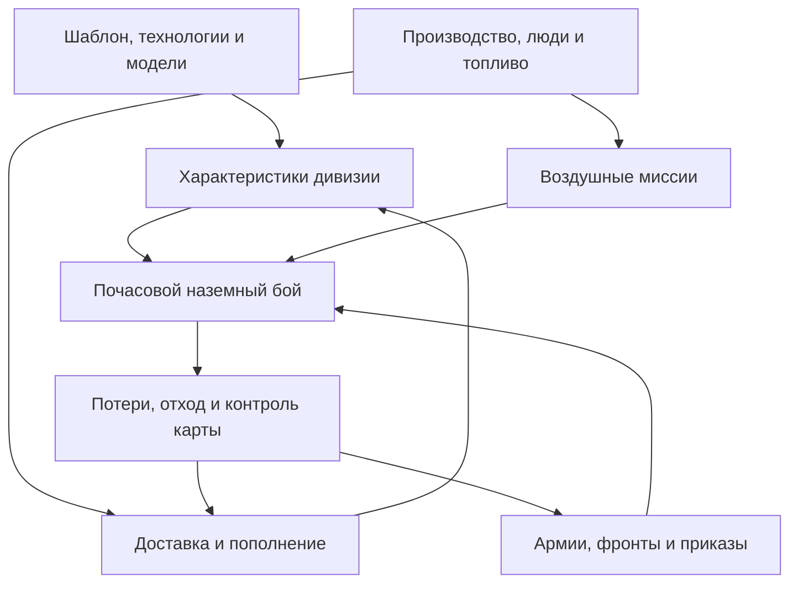

# Аудит военной симуляции и план доведения до HOI4

Дата: 28 октября 2026. Проверенный snapshot: **`ac0ee26d934a1df15d7b98ec43f479504fc31c11`**, ветка `feat/land-command-1193-20261026`. Все ссылки на исходники ниже закреплены на этом коммите. Игровые исправления в рамках этого аудита не вносятся; добавлены отчёт и воспроизводимые диагностические пробы.

## Вывод

Проект — **интегрированный прототип военной симуляции с работающим каркасом**, но пока не достоверная реплика боевой системы HOI4 1.19.3. Сильная сторона — единая кампания и разделённые подсистемы; слабая — правильность передачи состояния между ними, полнота версионных данных и оперативный ИИ.

Сказать «готово на 70%» нельзя: такого измерения нет. Наличие механики и точность её поведения — разные критерии. Простая часть наземного resolver ближе к заданной модели, чем снабжение, воздух, кампанийный ИИ и полная игровая экономика. Даже точное совпадение среднего урона не сделает кампанию эквивалентной, пока недоукомплектованная дивизия сохраняет полную атаку, котёл получает пополнение, а вылет расходуется несколько раз.

**303 штатных теста проходят. Дополнительные пробы воспроизводят восемь дефектов и три ограничения.** Это показывает пробелы покрытия: существующие тесты часто подтверждают отдельную операцию — например, списание техники — без проверки её последствий для следующей подсистемы.

Прежняя оценка, что сам вызов пересчёта после attrition гарантирует корректное ослабление дивизии, была слишком сильной. Вызов есть; проблема находится внутри агрегатора и в использовании его результата.

## Что именно проверено

- Прочитаны `session`, `warfare`, `military_model/data/history`, `logistics`, `support_import`, `air_warfare`, `land_combat`, `combat_rules/modifiers`, `frontline`, `operations`, `command/abilities`, `recruitment`, `campaign_save`, связанные UI/production/research точки и тесты.
- Заново выполнены `cargo test --all-targets -j1`, `cargo fmt --all -- --check`, `cargo check --all-targets -j1`, `cargo clippy --all-targets -j1`: exit 0. Clippy сохраняет предупреждения; `-D warnings` не заявляется.
- Штатные тесты: **65 library + 228 game + 3 exporter + 7 integration = 303**.
- Rust 1.99.1; отдельный target; dev/test: opt-level=0, debug=0, codegen-units=1, incremental=0. Эти параметры не меняют формулы симуляции.
- Отдельно запущены 11 диагностических проб в временном `git archive` проверенного коммита. Они не изменяют рабочие игровые исходники и не включены в обычный CI. **PASS этих проб означает воспроизведение указанного поведения, а не его правильность.**
- Оригинальная HOI4, Android APK/устройство, iOS, полная карта на Samsung A51 и новый визуальный UI smoke test в этом аудите не запускались. Release/Android-проверки прошлого этапа не выдаются за повторную проверку нового snapshot.
- В checkout нет эталонной локальной установки/валидированных golden logs 1.19.3. Сравнение с закрытым engine не выполнено.

Машиночитаемые результаты: [military-audit-2026-10-28-results.json](military-audit-2026-10-28-results.json).

Свежие изменения после предыдущего этапа учтены: резервирование грузовиков подключено к инициализации/часовому циклу, изменение парка инвалидирует сеть, операции rebase+mission валидируются атомарно. Исправление ёмкости силосов работает для новых состояний с корректно установленной базой; D7 относится отдельно к миграции старого состояния.

## Как сейчас связаны механики



`GameSession` владеет `World`, `Warfare`, исследованиями и производством. Армии и планы хранят ID существующих дивизий; отдельного несвязанного демонстрационного симулятора нет. Шаблон отделён от экземпляра; экземпляр хранит людей, оборудование, HP/ORG, опыт, позицию и приказы.

Фактический порядок часа, [session.rs:254](https://github.com/LissChenskie/hoi4andrrust/blob/ac0ee26d934a1df15d7b98ec43f479504fc31c11/src/session.rs#L254), [warfare.rs:2413](https://github.com/LissChenskie/hoi4andrrust/blob/ac0ee26d934a1df15d7b98ec43f479504fc31c11/src/warfare.rs#L2413):

1. Сверяются назначения логистических грузовиков; продвигается календарь.
2. Самолёты пополняются из модельного запаса.
3. Считаются доставка, запасы, национальное топливо, расход и attrition. Авиация раз в восемь часов рассчитывает вылеты.
4. Завершаются ручные маршруты, идёт подготовка новых дивизий, обновляются фронты и оперативные планы.
5. Обновляются командирские бонусы, восстановление организации, окапывание и planning.
6. Выполняется движение. Затем каждый активный бой последовательно разрешает свой час, отход и результат.
7. При изменении контроля обновляются фронты.
8. На суточной границе дополнительно идут исследования, производство, пополнение дивизий и строительство.

Следствие: корректность отдельных функций недостаточна. Сухопутный бой получает уже рассчитанные параметры, но доставка и пополнение проверяют разные условия. CAS выдаёт общий региональный результат, а наземные бои делят его по меняющемуся списку. Именно на этих переходах обнаружены самые серьёзные дефекты.

## Подтверждённые дефекты

Числа ниже относятся к авторским тестовым данным, не к историческому составу Франции и не к измерениям оригинальной игры. P0 — нарушение боевой/ресурсной корректности, которое следует закрыть первым; P1 — серьёзное, но следующее по порядку исправление.

### D1 · P0 · Недостаток техники не пропорционально ослабляет дивизию

**Проба:** 100 винтовок заменены одной. Soft Attack остаётся **50 → 50**, `strength()` остаётся **1.0**.

Причина: [military_model.rs:532](https://github.com/LissChenskie/hoi4andrrust/blob/ac0ee26d934a1df15d7b98ec43f479504fc31c11/src/military_model.rs#L532) нормализует доли моделей по *имеющемуся* количеству. Единственная оставшаяся модель получает вес 1 независимо от дефицита относительно требования 100. `strength()` определяется HP, а обычный износ HP не уменьшает.

Последствие: attrition действительно уничтожает вещи, но агрегатор до полного исчезновения соответствующего оборудования способен сохранять его полный вклад в атаку/защиту. Нельзя утверждать, что пересчитанные характеристики уже отражают степень оснащения.

Исправлять через отдельные правила идеальных и фактических характеристик, доли заполнения по архетипам и учёт людей. HP, ORG, width, armor/piercing, скорость и attacks требуют собственных политик; общее умножение всех stats на один процент породит другие ошибки.

### D2 · P0 · Пополнение пересекает разорванную сеть

**Проба:** логистика включена, доступных маршрутов нет, у дивизии ещё `supply_fraction=0.5` из переносимых запасов. После `replenish`: **500 → 1000 человек**, **1 → 100 винтовок**, национальные 99 винтовок списаны.

Причина: [warfare.rs:1220](https://github.com/LissChenskie/hoi4andrrust/blob/ac0ee26d934a1df15d7b98ec43f479504fc31c11/src/warfare.rs#L1220) проверяет `supply_fraction > 0`, а не доступность/выделенную мощность доставки. Остаток еды трактуется как разрешение мгновенного перевода людей и техники. `return_surplus` также возвращает ресурсы напрямую в национальный запас.

Последствие: окружение снижает обычное снабжение, но не изолирует материальное пополнение в течение периода сохранения положительного fraction. Местный выпуск тоже может поддерживать эту лазейку дольше.

Нужна единая политика перемещения ресурсов через сеть с явной совместимостью legacy-сценариев, где solver отключён. Наличие складского запаса не равно факту доставки в дивизию.

### D3 · P1 · Переносимое снабжение не восстанавливается

**Проба:** после **49 часов полной доставки** пустой запас остаётся **0**, хотя fraction=1. При следующем разрыве пути fraction сразу становится 0.

Причина: [logistics.rs:707](https://github.com/LissChenskie/hoi4andrrust/blob/ac0ee26d934a1df15d7b98ec43f479504fc31c11/src/logistics.rs#L707) ограничивает `received` текущим потреблением. Поэтому `received/24 - required` не может быть положительным. Запас может расходоваться или сохраняться, но штатно не пополняется.

Нужно разделить текущее потребление и запрос восстановления переносимого запаса. Оба должны занимать реальную мощность доставки. Скорость восстановления затем калибровать по целевой версии.

### D4 · P0 · Порядок завершения боёв увеличивает бюджет CAS

**Проба:** два реальных боя, 100 доступных воздушных attack-roll units/час. Первый получает 50 и заканчивается по ORG; второй получает уже 100. При неактивном width cap суммарный HP damage — **5.25 вместо максимально допустимых 3.5** для того же исходного бюджета.

Причина: [warfare.rs:1747](https://github.com/LissChenskie/hoi4andrrust/blob/ac0ee26d934a1df15d7b98ec43f479504fc31c11/src/warfare.rs#L1747) пересчитывает делитель для каждого боя. В [warfare.rs:2552](https://github.com/LissChenskie/hoi4andrrust/blob/ac0ee26d934a1df15d7b98ec43f479504fc31c11/src/warfare.rs#L2552) бои обходятся последовательно, и уже закончившийся бой перестаёт входить в делитель.

Нужен общий часовой снимок и расходуемый бюджет по стране/региону с учётом уже выделенных самолётов и урона. Перераспределять можно только ещё не использованный остаток.

### D5 · P1 · Малый CAS-парк исчезает при целочисленном делении

**Проба:** один CAS-самолёт и два доступных боя. Каждый получает `cas_planes=0`, хотя attack input равен 0.5 на бой. Оба наземных боя получают **нулевой CAS damage**.

Причина: целочисленное `1 / 2` в том же распределителе и последующая проверка [land_combat.rs:912](https://github.com/LissChenskie/hoi4andrrust/blob/ac0ee26d934a1df15d7b98ec43f479504fc31c11/src/land_combat.rs#L912), требующая положительного числа самолётов.

Нужно сохраняющее количество распределение целых самолётов/остатков: например, детерминированно назначать доступный самолёт конкретному бою с последующей ротацией/приоритетом. Точный выбор цели следует сверить с оригиналом; терять весь доступный ресурс при округлении нельзя.

### D6 · P0 · Новые формирования получают топливо без источника

**Проба через настоящую очередь подготовки:** национальное топливо **0**, списано **0**, у новой подготовленной части после её первого логистического часа переносимый запас **23.9**, fuel readiness **100%**.

Причина: [recruitment.rs:225](https://github.com/LissChenskie/hoi4andrrust/blob/ac0ee26d934a1df15d7b98ec43f479504fc31c11/src/recruitment.rs#L225) использует исторический конструктор, который выставляет [fuel_fraction=1](https://github.com/LissChenskie/hoi4andrrust/blob/ac0ee26d934a1df15d7b98ec43f479504fc31c11/src/warfare.rs#L504). Затем [logistics.rs:647](https://github.com/LissChenskie/hoi4andrrust/blob/ac0ee26d934a1df15d7b98ec43f479504fc31c11/src/logistics.rs#L647) материализует запас из этого fraction.

Исторический старт может законно задавать явно импортированное бортовое топливо. Новая дивизия должна получать его из учтённого источника. Нужно разделить эти способы инициализации, сохранив единственный runtime экземпляр дивизии.

### D7 · P1 · Старые сохранения могут повторно учитывать силосы

Для новых состояний исправление ёмкости уже работает. Проблема относится к старому save, где отсутствует `fuel_capacity_base`, а `fuel_capacity` уже содержит вклад силосов.

**Проба:** старая общая ёмкость 2000 = 1000 базы + 1000 силоса. Первый новый tick делает **3000**; после утраты силоса остаётся **2000 вместо 1000**.

Причина: [logistics.rs:617](https://github.com/LissChenskie/hoi4andrrust/blob/ac0ee26d934a1df15d7b98ec43f479504fc31c11/src/logistics.rs#L617) принимает старую общую ёмкость за базовую и прибавляет силосы ещё раз. Исходная база и вычисленный total неразличимы без версии/provenance.

Нужна миграция схемы с использованием исходного профиля либо явной диагностикой неоднозначности. Простое вычитание текущих силосов не универсально: предыдущая версия могла уже сохранить завышенный total после потери территории.

### D8 · P1 · Модификатор reliability теряется

**Проба:** reliability модели 0.8, распознанный equipment modifier +25%. Итог агрегатора остаётся **0.8**, хотя его собственный промежуточный расчёт даёт 1.0.

Причина: после обработки модификаторов результат заменяется средним из исходных model definitions, [military_model.rs:692](https://github.com/LissChenskie/hoi4andrrust/blob/ac0ee26d934a1df15d7b98ec43f479504fc31c11/src/military_model.rs#L692). Кроме того, attrition для известной модели вновь читает сырой catalogue reliability, [logistics.rs:776](https://github.com/LissChenskie/hoi4andrrust/blob/ac0ee26d934a1df15d7b98ec43f479504fc31c11/src/logistics.rs#L776).

Поэтому исправления одного отображаемого stat недостаточно: wear solver должен получать тот же эффективный reliability с учётом применимых модификаторов. Политики maintenance/support и technology modifiers нужно проверить отдельными fixtures.

## Воспроизведённые ограничения, которые нельзя автоматически назвать багами оригинальной механики

Эти три пробы отделены от восьми дефектов выше.

| Проба | Наблюдение | Оценка |
|---|---|---|
| Топливная доставка | При supply flow около 0.0005 из потребности 24 дивизия получает 25 fuel units и readiness=1 | Fuel проверяет достижимость, но не участвует в capacitated solver. Нормализация transport units и правила fuel delivery ещё не определены; нельзя напрямую приравнивать supply unit к fuel unit |
| Пополнение самолётов | При пустой зоне логистической доступности контролируемая авиабаза получает 100 самолётов из запаса за вызов | Есть списание техники, но нет модели перегонки/времени/дальности пополнения. Самолёты потенциально могут прилетать на изолированную базу; запрещать это по сухопутному правилу без проверки оригинала неправильно |
| Army XP | 48 часов учений продвигают training state, Army XP остаётся 0 | В обычном часовом цикле не обнаружены источники Army XP от учений/сражений. Исторические/script inputs способны выдать стартовый XP; обычная прогрессия отсутствует, после расходования стартового опыта конструктор теряет важный игровой цикл |

## Что уже близко по устройству, а что ещё далеко

| Подсистема | Подтверждено в нашем коде | Что мешает паритету |
|---|---|---|
| Часы/RNG | Часовой scheduler, seedable RNG, накопление урона до изменения сторон одного боя, trace | Межбоевые ресурсы требуют общего snapshot; нет engine golden logs |
| Атака/защита | SA/HA через hardness, Defense/Breakthrough по роли, общий защитный бюджет, stochastic rounding, 10%/40% | Точные промежуточные округления и modifier ordering не сверены с 1.19.3 |
| HP/ORG/потери | Раздельные HP и ORG, d2/d4, d6 при заданном броневом условии, списание людей/моделей с дробными остатками | Конкретный pipeline брони/потерь требует эталона; оснащённость ошибочна D1 |
| Armor/Piercing/width | Отдельные агрегаторы, ступени piercing, terrain/directions, width и stacking | Проверить состав учитываемых компонентов, границы и действительные числа версии |
| Резервы | Отдельные frontline/reserve, initiative в chance | Только одна попытка подходящего резерва на сторону/час: после неудачи цикл прерывается, после успеха возвращает одного. Это ограничение реализации; нужное распределение 1.19.3 требуется измерить |
| Тактики | Trigger/weight, phases, counters, 12-hour cycle | Закрытый recon/counter picker не восстановлен; `Tactic.movement` импортируется, но не используется; часть условий/модификаторов не исполнена |
| Командование | Армии/группы/театры, генерал/FM, skills, поддерживаемые traits/abilities, командирский XP | Полное получение traits, точные XP/skill rules, HQ capture/proximity edge cases, современная doctrine linkage |
| Division Designer | Сетка, support/regimental slots, XP-стоимость, требования, сохранение, исследования | D1/D8; battalion_mult, essential equipment, новые доктрины/mastery и варианты импортированы неполно; нет версии golden set |
| Снабжение | Настоящий граф, рельсы/хабы/порты, контролируемые пути, локальный выпуск, грузовики и конвои | D2/D3; поезда, rail damage/repair, налёты, совместная пропускная способность ресурсов, релокация столицы, supply-dependent max ORG и более точная доставка |
| Топливо | Национальный и переносимый запас, нефть/НПЗ, реальный расход | D6/D7; полный oil/trade pipeline, калибровка потребления и транспортные мощности |
| Attrition | Реальные модельные потери, terrain/weather/supply/exercise inputs | D1/D8; точная формула, maintenance и полноценный износ логистического парка |
| Авиация | Регионы, базы, fuel/range/capacity, superiority/interception/CAS, потери и пополнение | D4/D5; самолётные effective modifiers, detection/radar/aces/опыт, большая часть миссий, перелёты/варианты и air AI |
| Погода | Поддерживаемые модификаторы участвуют в бою/скорости/износе | Состояние задаётся profile input; динамического погодного календаря/генератора не обнаружено |
| Фронты/планы | Геометрия графа, сектора/котлы, минимальная стоимость назначения, ручной приоритет, режимы исполнения | Coverage тестов узкое; supply назначения оценивается через текущее состояние части, а не полноценный прогноз назначения |
| Оперативный ИИ | Реальные приказы, готовность, направления, рельеф/реки/форты, исполнение цели | Предсказатель сравнивает в основном SA+HA, strength и planning; не повторяет nonlinear resolver, плохо отражает armor/hardness/defense/supply и оперативные риски |
| ИИ страны | Есть выбор исследований и простое поведение неназначенных частей | Неназначенные части раз в 6 часов выбирают первого соседнего врага, глобально максимум восемь атак. Это не полноценный country/army AI; автоматического управления воздушной войной не обнаружено |
| UI | Подключённые армейские/авиационные экраны и показатели, touch draft/confirm, боевой журнал | Изменение полосок должно объясняться факторами, дефицитом и маршрутом. В этом аудите новый visual/device QA не выполнялся |
| Сохранения | Единая кампания, RNG/приказы/ресурсы, проверка fingerprint, dispatch state | Миграции схемы требуют отдельной версии и тестов старых файлов; D7 |
| Полная кампания HOI4 | Экономика/исследования связаны с военной частью | Флот, торговля, политические решения/фокусы, законы, оккупация/compliance/resistance, капитуляции/мир и стратегический AI остаются большими самостоятельными слоями |

Код, подтверждающий ограничения: [reserve loop](https://github.com/LissChenskie/hoi4andrrust/blob/ac0ee26d934a1df15d7b98ec43f479504fc31c11/src/land_combat.rs#L596), [AI prediction](https://github.com/LissChenskie/hoi4andrrust/blob/ac0ee26d934a1df15d7b98ec43f479504fc31c11/src/operations.rs#L707), [упрощённый country AI](https://github.com/LissChenskie/hoi4andrrust/blob/ac0ee26d934a1df15d7b98ec43f479504fc31c11/src/warfare.rs#L2610), [placeholder панели](https://github.com/LissChenskie/hoi4andrrust/blob/ac0ee26d934a1df15d7b98ec43f479504fc31c11/src/campaign_ui.rs#L127).

Отдельное ограничение пространственной модели: одна дивизия хранит `battle: Option<id>`. Входящая атака прерывает её исходящий бой ([warfare.rs:1957](https://github.com/LissChenskie/hoi4andrrust/blob/ac0ee26d934a1df15d7b98ec43f479504fc31c11/src/warfare.rs#L1957)); после победы вход в провинцию начинается с progress=0. Полноценное взаимодействие связанных боёв, pinning и движения во время боя требует отдельного сравнения с оригиналом, а не косметического исправления UI.

### Важная проверка единиц урона

В **текущем дефолтном профиле проекта** attacks/defenses делятся на 10 перед бросками. Поэтому тест низкоуровневого `resolve_hits(100, 50)` использует **100 бросков**, а не 100 единиц Soft Attack.

При нейтральных модификаторах, hardness=0, без броневого преимущества:

| Raw SA / Defense | Броски A / D | E[hits] | E[ORG damage/h] | E[HP damage/h] |
|---|---|---|---|---|
| 100 / 100 | 10 / 10 | 1 | 0.1325 | 0.09 |
| 100 / 50 | 10 / 5 | 2.5 | 0.33125 | 0.225 |

Это аналитическая проверка наших constants/units. Она не доказывает паритет с конкретным patch. Сравнение, в котором raw SA=100 подставляется как 100 бросков, ошибается в масштабе в десять раз ещё до остальных модификаторов.

## План работы

Общая цель каждого этапа — законченный, проверяемый результат в существующей кампании. Приёмка: целевые regression tests, отсутствие регрессии штатного набора, fmt/check/clippy, сборки по затронутым платформам и конкретный сценарий. Новый процент готовности не подменяет эти проверки.

| Этап | Работа | Обязательный выход / критерий окончания |
|---|---|---|
| **1. Корректность состояния** | D1/D2/D3/D4/D5/D6/D7/D8; связать идеальные/фактические stats, ресурсы и доставку; ввести часовой CAS budget и миграцию legacy capacity | Неполное оснащение меняет положенные stats, котёл не получает наземные пополнения, запас восстанавливается, новые части не создают fuel, CAS не теряет/дублирует ресурс; все соответствующие positive regression tests зелёные |
| **2. Зафиксированные данные 1.19.3** | Проверенный source version/checksum/DLC, нормализованные definitions и provenance, fixtures из оригинального UI; расширить battalion_mult/essential/variants и doctrine data | Golden templates: 1/несколько INF, ART/support ART, MOT/MECH, ARM, ENG/SIG/LOG, regimental support; отдельные таблицы по tech/model/оснащённости. Неизвестные semantics явно диагностируются |
| **3. Наземный resolver** | Распределение целей/coordination, reserves, modifiers, armor/damage, tactics, боевая часть XP; сравнить связанный combat/movement | Boundary tests и статистические sweeps; replay hourly trace. Критерии mean/quantiles/win rate согласуются заранее, затем проверяются на golden combat set |
| **4. Логистика и перемещения** | Поезда/пропускная способность разных ресурсов, grace/refill, supply max ORG/recovery, rail/port damage/repair, capital relocation, стратегическая переброска | Котёл → истощение → восстановление; смена столицы, потеря порта/силоса, дефицит поездов, два фронта и ограниченная поставка. У каждого ухудшения есть объяснимый источник |
| **5. Прогрессия и конструктор** | Army XP от подтверждённых источников, опыт/потери опыта соединений, commander traits/XP, 1.19 doctrine/mastery и regimental support; фактические requirements и re-equipment | Учения/бой → XP → изменение шаблона → дефицит → реальная доставка → изменённый бой, без создания людей/оборудования и двойного применения modifiers |
| **6. Воздушная война** | Effective aircraft stats по technology/doctrine/country, подтверждённые варианты, detection/radar/experience/миссии, перелёты и пополнение, воздушный AI | Воспроизводимые air-vs-air и air-to-land сценарии; смена mission/base даёт объяснимый результат; противник сам использует авиацию; общий fuel/plane budget сохраняется |
| **7. ИИ и фронт** | Country AI создаёт/оснащает армии и цели, operational AI использует прогноз реального боя и снабжения, резервы/разрывы/котлы; tactical choices остаются внутри battle | Удержание 12/8, несколько фронтов, прорыв, закрытие/ликвидация котла, отмена невыгодной атаки, ручное отклонение и возврат, без массового бесполезного движения |
| **8. Мобильная приёмка и масштаб** | Объяснимые панели фактических stats/дефицита/маршрутов, draw/input regressions, event invalidation/память/CPU, профиль A51 и desktop | Полная пользовательская цепочка FRA → 12 дивизий → армия/генерал → фронт/план → бой/CAS → ручной приказ → новый шаблон/оснащение → новый фронт → save/load; измерения на полной карте и физическом устройстве |

### Дальний горизонт полной игры

Этапы 1–8 дают критерий приёмки военной части. Полное воссоздание HOI4 требует ещё самостоятельных блоков:

9. **Экономика войны и торговля:** реальные ресурсы/импорт, законы и мобилизация, производственные ограничения, оккупация и её влияние на ресурсы/заводы.
10. **Морская война:** флоты, конвои, миссии, морские бои, блокада/потери перевозок, высадки и взаимодействие с авиацией/снабжением.
11. **Кампания стран:** политические решения, события/фокусы, дипломатия/фракции, капитуляции, перемирия/мир и изменение государств.
12. **Общая кампания и её AI:** согласованная стратегия всех стран, длительные исторические/альтернативные сценарии, полный save compatibility и производительность на целевых устройствах.

Это отдельный большой объём, а не оставшиеся несколько деталей после land resolver. Его стоит детализировать после стабилизации военного ядра; текущие политики/фокусы/флот в интерфейсе ещё помечены placeholders.

### Первые три исправляющих коммита этапа 1

1. **Оснащение и modifiers:** D1/D8; positive tests на 0%, 1%, 50%, 100% оборудования, mixed models, reliability/tech/maintenance; отследить отсутствие двойного strength penalty.
2. **Ресурсы и доставка:** D2/D3/D6/D7; источник каждого приращения людей, техники, fuel и переносимого снабжения; разделение исторического старта и runtime deployment; versioned save migration.
3. **CAS scheduler:** D4/D5; фиксированный часовой snapshot/счётчик остатков, целочисленное распределение, завершение боя в середине обхода, неизменность общего бюджета при перестановке ID боёв.

Первые исправления нужно делать малыми изменениями. Существующий граф карты, authoritative state, генератор приказов и прочие рабочие возможности сохраняются. Статистический parity нельзя начинать с подгонки коэффициентов, пока не закрыты нарушения сохранения ресурсов и масштаба фактических stats.

### Правило дальнейших проверок

- У каждой заявленной механики есть: источник, модель состояния, исполняемый путь, наблюдаемое последствие и тест этого последствия.
- Каждая найденная проблема превращается в тест на **правильное** поведение; текущие observe-пробы не надо включать как «зелёный критерий» релиза.
- Перед сравнением с оригиналом фиксируются version/DLC, raw stats, equipment fill, commander/weather/supply/air, число направлений, tactics и единицы attack rolls.
- Примерный первоначальный gate для подтверждённого P0 resolver: ошибка средних менее 2%, хвостов p05/p95 менее 5% на достаточной выборке и без систематического drift по sweep. Это предложенный критерий нашего проекта, не официальная гарантия Paradox. Без оригинальных samples этот gate нельзя объявлять пройденным.
- Кеши и scheduler проверяются на одинаковое продолжение после save/load, перестановку независимых событий, отсутствие повторного расхода одного часа и корректную инвалидацию.
- Производительность измеряется отдельно от математической точности. Старый результат «около 2 ms на 100 дивизиях и маленьком графе» не доказывает пригодность полной кампании для A51. Cargo.lock приложения не отслеживается в проверенном Git snapshot; для воспроизводимой сборки приложения его нужно зафиксировать. Пробы этого аудита используют отдельный сохранённый lockfile и `--locked`. Особые риски: Dijkstra по многим исходным провинциям, Hungarian O(n³), копии residual graph во время supply allocation, проходы по всем дивизиям для каждого air wing/боя и частые пересчёты при захватах.

## Версия эталона и источники

Цель этого плана остаётся **1.19.3**, как в задании. Официальная лента уже содержит **1.19.4 от 27 октября** с дополнительными изменениями stats/doctrines. Их нельзя молча использовать для «исправления» 1.19.3. В 1.19.3 отдельно менялись артиллерия, support/regimental units и fuel usage, поэтому старые калькуляторы не являются достаточным oracle.

Первичный источник changelog: [официальная лента HOI4 в Steam](https://store.steampowered.com/news/posts/?appids=394360&feed=steam_community_announcements). Прямые страницы Wiki Land battle/Logistics/Air missions при проверке вернули 401. Непроверенные копии defines из модов не использовались для утверждения точных чисел vanilla 1.19.3. Собственный исходник закреплён на указанном snapshot; оригинальный закрытый engine не анализировался.

## Повторный запуск проб

Требуются Python 3.12+, Git и доступный Cargo/toolchain. Из checkout:

```shell
python tools/audit/run-military-probes.py --ref ac0ee26d934a1df15d7b98ec43f479504fc31c11
```

Для альтернативного Cargo: `--cargo PATH_TO_CARGO`. Зависимости берутся из сохранённого lockfile пробы; несовместимое изменение Cargo.toml не разрешается молча через новые версии. Копия создаётся во временном каталоге и удаляется после запуска; исходные игровые файлы остаются без изменений. Пробы закреплены на этом snapshot и используют его авторские test helpers. После исправлений успешный audit-run старого snapshot по-прежнему воспроизводит старые дефекты; для проверки новых реализаций нужны positive regression tests текущего кода.

Файлы данного аудита: этот отчёт, JSON результатов, `tools/audit/military_probes.rs`, `tools/audit/run-military-probes.py`, `tools/audit/cargo-ac0ee26.lock`. Следующая работа — три исправляющих коммита этапа 1, затем версия данных и контрольные сценарии.
