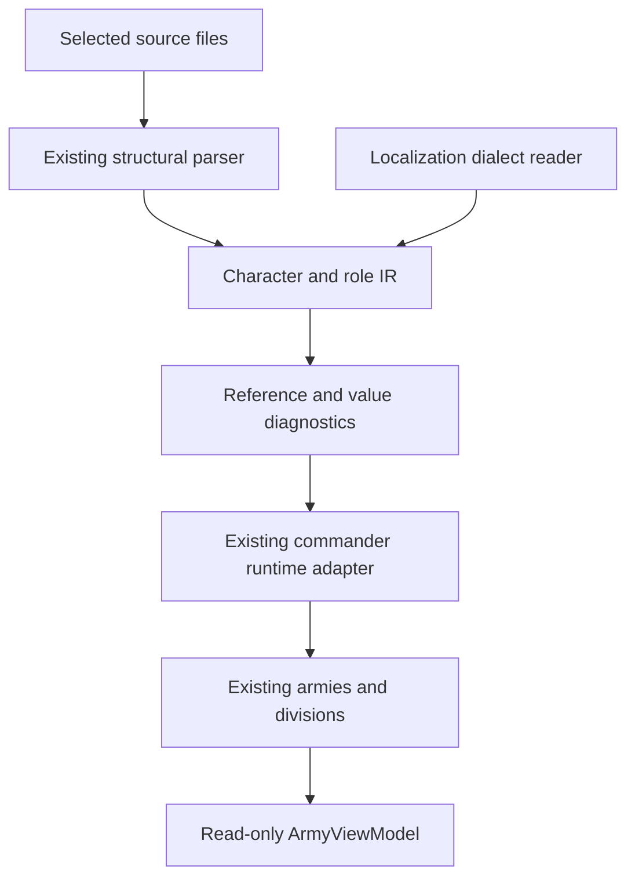

# Commander data → existing Rust simulation → mobile projection

Schema proposal **0.1.0**, converter **0.1.0**, 27 October 2026.
This is an implemented import/data slice. The new touch screen is deliberately
pending schema approval requested in the task. Existing army controls remain
usable; no new buttons or replacement engine are introduced in this change.

## A. Source inventory and representative sampling

No installed HOI4 directory or complete 1.19.3 dataset exists in this checkout.
The Windows installation path supplied by the player cannot be read from this
Linux environment. A patch number in a task is not proof of the input version.
`source_version` therefore remains null unless supplied by actual dataset metadata.
Earlier 1.15.4 material is not relabeled as 1.19.3.

| File/directory | Purpose/entities | Existing parser/requirements | Risk / observed status |
|---|---|---|---|
| `src/pdx.rs` | Ordered AST, operators, repeated keys, source spans | Existing lexer/parser; UTF-8 BOM | Retain source text for comments; not a source rewrite tool |
| `src/command.rs` | Authoritative commander XP, armies, groups, theaters, membership | Now consumes `CommandData` | Existing highest-rank runtime policy preserved |
| `src/military_data.rs` | Unit/equipment catalogue, OOB templates, overlays | Structural parser, explicit layers/replace_path | Not replaced by a duplicate converter |
| `src/military_history.rs` | Bookmark/DLC selection, divisions, countries | Existing condition resolver | New command projection included in import report |
| `src/warfare.rs` | Orders, movement, battle/economy integration | Existing authoritative divisions | No copied runtime divisions in UI state |
| `src/army_ui.rs`, `src/army_command_ui.rs` | Selection, roster, assignment, hierarchy | Existing Macroquad widgets | Screen redesign awaiting schema decision |
| `src/campaign_save.rs` | Atomic whole-campaign save/restore | Existing schema 1 | Immutable command source data reattached after restore |
| `common/characters/*.txt` | Character + commander profiles | Structural parsing; duplicate singleton detection | Unknown roles/fields preserved |
| `common/unit_leader/*.txt` | Trait definitions/modifiers/conditions | Ordered AST retained | Preserving a rule does not implement it |
| `history/countries`, `history/units` | Recruitment, chosen OOB, templates/instances | Existing date/DLC resolver | No complete historical corpus available here |
| `localisation/*.yml` | Language/key/value | Dedicated dialect reader; header, BOM, escapes | No recursive `$KEY$` or scripted formatting expansion yet |
| `interface`, `gfx` | UI grouping/asset refs | Current own UI examined | No vanilla GUI/image extraction |

Representative **authored** corpus in `tests/fixtures/command-data`:
three character files (`basic`, `multirole`, `marshal`), one trait set,
two unit/OOB files (1936/1939), country recruitment, English/Russian BOM
localization. The source examples belong to this repository; their numbers and
names are not claims about historical HOI4 units or balance.

## B–E. Canonical entities, mapping and compatibility

The executable, serde-compatible schema is `src/command_data.rs`:

```text
CommandData 0.1.0
  source_version: Option<String>
  characters: ID -> Character
    id, name_key, profile_ids[], portrait AST refs, source, unknown_fields[]
  profiles: ID -> CommanderProfile
    id, character_id, role, stats, trait_ids[], initial_experience,
    source, unknown_fields[]
  traits: ID -> TraitDefinition
    id, name_key, description_key, full fields AST, source
  localization: language -> key -> value
  sources: normalized path -> original text + ordered AST
  diagnostics: severity, code, message, source
```

`SourceMetadata` is `{file, object_id, line, source_version}`. Source hashes are
optional in the requested design and are not implemented here; no invented hash
is presented as cryptographic provenance. Raw text preserves comments while AST
spans retain positions/operators/repeated fields. This is not an editable CST.

| Source path/field | Source type | Target | Conversion / loss / validation |
|---|---|---|---|
| `characters.ID` | block | `Character.id` | Preserve ID; duplicate ID is error |
| `name` | atom | `Character.name_key` | Keep key/literal; missing translation warning |
| `portraits` | block | `Character.portraits` | Preserve AST GFX refs, copy no images |
| `corps_commander`, `field_marshal` | block | distinct `CommanderProfile` | ID `character::source_role`; both survive |
| `skill`, four specialized skills | integer atom | optional unsigned stats | No numeric expression guessed; invalid/missing value is error |
| `experience` | number atom | `initial_experience` | Finite nonnegative; absent = existing initial zero policy |
| `traits` | atom list | `trait_ids` | Keep unknown ID, warn, no invented effect |
| `leader_traits.ID` | block | `TraitDefinition.fields` | Preserve complete AST including conditions/XP rules |
| modifier blocks | block | existing `CommandRules.traits` | Existing shared/general/marshal scopes retained |
| unknown character/role fields | arbitrary | `unknown_fields` + original document | Preserve, count; no execution inferred |
| localisation entry | dialect line | language/key/value | Requested language → English → key/literal |
| country `recruit_character` | reference | existing runtime commander | Existing date/DLC selection; unresolved reference diagnosed |
| `division_template.regiments/support` | positioned blocks | existing `DivisionTemplate` | Existing x/y and separate support preserved by existing importer |
| division `location/template/experience` | OOB fields | existing `Division` | Existing OOB resolver; no additional units instantiated |
| army membership | runtime IDs | `ArmyViewModel.division_ids` | Read existing membership; never copy unit simulation state |
| supply demand/fraction | runtime numbers | requested/received/ratio summary | Demand-weighted; no fabricated bottleneck/reserve days |
| HQ | versioned validated profile | existing optional physical HQ | Feature remains disabled without verified input rules |

Character, base role profile and runtime commander XP/assignment are separated:
`CommandData` is immutable import projection; `CommandState.commanders` remains
campaign authority. Armies still refer to one commander ID and one membership
index. Templates, instances, equipment, orders, fronts, plans, logistics fractions,
HQ entities continue using their existing types. This change does **not** claim
to have migrated those complete subsystems to a universal IR.

Both profiles are preserved, but the current runtime adapter selects field
marshal when both roles are declared, matching prior behavior. It does not
create two independent characters or duplicate XP. Role switching with separate
profile-specific progression needs a later schema/rules decision. Invalid or
ambiguous character definitions are reported and excluded from recruitment.

Canonical version `0.1.0` is a proposal, not a stable public format. No migration
from arbitrary future packages or `.hoi4` save import is promised. Existing game
saves remain schema 1: source definitions are omitted from saves and reattached
from the current import after restore; saved commander XP/stats are retained.

## F–G. Implemented pipeline and code



- `src/command_data.rs`: independent data model, parser adapter, locale reader,
  reference diagnostics and summary; no Macroquad dependency in this module.
- `src/command.rs`: real game importer consumes that model instead of separately
  parsing/dropping the same fields. Existing traits still feed real combat rules.
- `src/army_projection.rs`: read-only army/commander projection. No simulated
  supply hubs, fictional XP thresholds or replacement divisions are created.
- `src/bin/hoi4-command-data.rs`: headless inspector/compiler for one **effective
  source directory**, not a second game or automatic DLC/mod selector.
- `data/hoi4/military-import-report.json`: the game's local import report now
  includes `command_data`, `command_summary` and `army_views`.

Inspector example (Windows, project root):

```powershell
cargo run --bin hoi4-command-data -- data\hoi4 command-data-review.json
```

A third positional argument may record a **verified** source version. Omit it if
unknown. The command emits diagnostics even on semantic errors (exit code 2);
I/O/usage failures return 1; valid conversions return 0. It never imports images,
executes scripts or writes to source data. Use the game's existing loader for
configured overlays and DLC/country/bookmark evaluation. This tool alone does
not produce a complete military runtime asset package.

## H. Proposed UI contract — not generated before schema approval

| Screen | View/model and purpose | Phone / tablet and touch | Empty/error state |
|---|---|---|---|
| Strategic map/army card | `ArmyViewModel`: counts, Org, strength, supply, plans | Collapsible card / persistent sidebar; tap selects | Empty army has null ratios, never misleading 0% |
| Commander details | `CommanderViewModel`: active skills, XP, trait IDs and descriptions | Sheet / inspector; tappable trait rows; visible Back | Unknown trait shown with ID and missing-definition status |
| Army details/roster | Authoritative division IDs and existing roster | Virtualized expanded sheet / list | Destroyed units excluded; wrong-country query rejected |
| Orders | Existing front/plan IDs and action methods | Visible mode, preview, confirm/cancel, persistent Back | Unreachable/invalid geometry keeps error and cancels no existing order |
| Designer | Existing template/derived stats/requirements | Composition/Stats/Equipment tabs; preserve x/y | Unavailable component gives existing unlock reason |
| Logistics | `ArmySupplySummary` | Summary + details when solver provides them | Unknown bottleneck/reserve explicitly absent |
| HQ | Existing validated optional HQ | Conditional management sheet | Hidden/disabled if verified rules absent |

Touch targets should be at least the requested ~48dp; multi-select must be an
explicit mode, and drag/pinch must not issue movement orders. No new touch
layout, hit regions, portrait assets or confirmation interaction are part of
this data change. Existing mouse/touch army controls are preserved.

## I. Performance findings

- Parsing is currently campaign initialization/import time, outside combat and
  render ticks. A fully precompiled runtime dataset is a future migration;
  claiming the current application never reads TXT at startup would be false.
- Runtime commander localization retains only referenced names/trait keys;
  it does not retain all localization source text. Headless inspector preserves
  full selected source files for review.
- Raw character/trait documents plus AST increase import-time memory. No measured
  full-1.19.3 memory figure is available. A future cooked package should separate
  debug provenance from hot runtime data rather than discard it from the tool.
- ViewModel construction scans the selected army membership and plan index on
  demand. It is not automatically built for all armies every render frame.
- Source definitions are skipped in saves; restoring them does not reissue units,
  reset XP, create equipment or change army assignments.
- Future UI should cache projections using membership/order/commander dirty events;
  `command.revision` alone does not track hourly Org/XP/supply changes. A revision-
  only UI cache would show stale values and has not been introduced.
- Existing pathfinding/front/supply hot paths are untouched; there is no new
  per-division thread, continuous parser or army-tree full rebuild per frame.

## J. Source/assets and licensing

No external implementation was copied and no new dependency added. Existing
project structural parser remains in use; Jomini was examined as an alternative
and is MIT, but replacing a working parser was unnecessary for this slice.
No third-party fixture corpus was copied. Test source/expected files are original
authored examples. The only portrait field is an unresolved GFX reference to an
own placeholder; no HOI4 textures, portraits, `.gui`, executable or logos enter
the build. Future source-package licensing remains distinct from engine code.

## K. Migration report and tests

The deterministic inspector golden fixture contains **6 source documents,
3 characters, 4 commander profiles, 1 trait, 7 localized values, 1 warning,
0 errors**. The warning is the intentional retained `unknown_trait` reference.
There are 3 preserved unknown character/profile fields; full trait AST is also
retained. Two additional OOB examples and one country file exercise the existing
runtime importer in the integration test, not this commander-only inspector.
These counts describe the authored corpus, not the player's installation.

Tests cover basic/multirole/marshal import, source lines, unknown properties,
duplicate properties/IDs, invalid values, unknown traits, BOM/localization
fallback/escaped quotes/malformed strings, broken character/profile references,
selective locale retention, deterministic full JSON golden/roundtrip, and actual
country/OOB → runtime division/army → localized projection integration.

## L. Unresolved semantics and next step

| Unknown / example | Where / confidence | Current handling | Required action |
|---|---|---|---|
| Actual 1.19.3 inputs/checksum | Installation unavailable / unknown | Do not infer from task | Export verified metadata and data |
| `future_role_field`, unknown nodes | Authored `basic.txt` / no semantics | Preserve AST/source | Implement only from documented applicable rule |
| `unknown_trait` | Authored `marshal.txt` / missing definition | Warn, keep ID, no invented bonus | Supply definition or correct reference |
| Full trait XP/conditions | Trait AST / preserved, not executed wholesale | Existing supported modifier scopes only | Extend typed resolver with versioned tests |
| Two roles, one active runtime character | `multirole.txt` / adapter policy known | Preserve both; highest rank runtime | Approve active-role/progression contract |
| HQ 1.19 proximity/capture/abilities | No verified local source | Existing version/DLC profile gate | Exact rules and controlled comparisons |
| Localization scripted expansion | `$KEY$`, formatting expressions / unresolved | Preserve literal text | Dedicated renderer/expansion with recursion limits |
| Full universal IR for templates/logistics/orders | Existing runtime types | Reuse, do not create second simulation | Decide migration boundaries before widening schema |
| iOS build / real touch device | Toolchain/device unavailable | No platform support claim | macOS/iOS toolchain and Android device QA |

Next step after schema approval: bind the existing officer/army entry points to
an adaptive commander/army screen with visible multi-select and explicit order
preview/confirmation, without introducing another competing toolbar.
